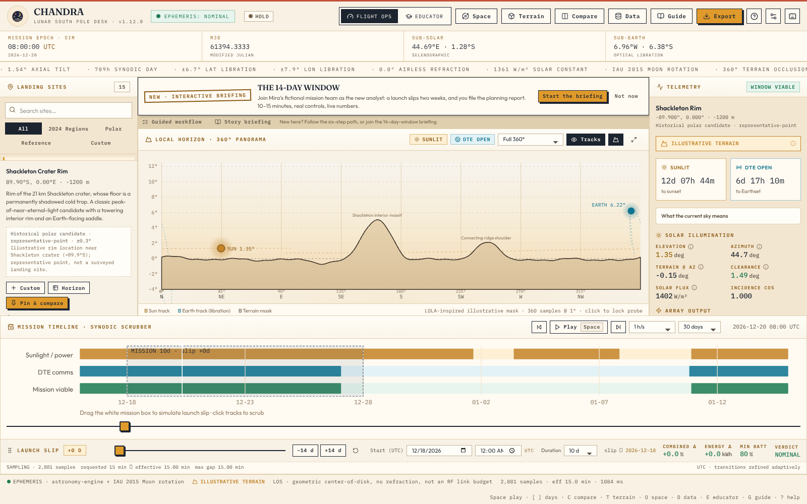
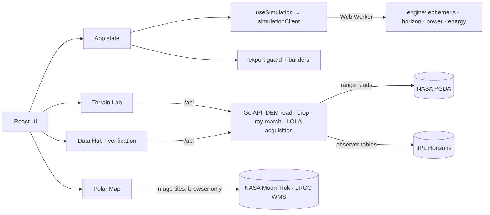

# CHANDRA

## Hosted Website

CHANDRA is available as a hosted web application. You can access the live version using the link below:

**Live Website:** [CHANDRA – South Pole Landing Navigator](https://chandra-jet.vercel.app/)

Open the website in your browser to explore the lunar mission planning and analysis features.
South-pole landing-site analysis for mission planners, educators and the public.

CHANDRA helps users compare lunar south-pole candidate sites and UTC mission
dates. It visualizes the Sun and Earth relative to each site's local terrain
horizon, estimates sunlight availability and solar-array output, and identifies
potential direct-to-Earth visibility windows. A browser application (React +
TypeScript) runs the scientific engine in a Web Worker, with an optional Go API
for validated lunar elevation models, bounded LOLA/PDS subset acquisition and
independent NASA/JPL Horizons checks.

The project started as a NASA Space Apps Challenge concept and has since been
rebuilt as an analysis tool with explicit data provenance. It is not a NASA
application, and nothing here is flight software. Every result is labeled with
what the underlying data supports: illustrative terrain, synthetic demo
terrain, and frame-verified DEMs are distinct confidence tiers, and analyses
that fail validation are blocked rather than quietly degraded.



## What it does

- **Candidate sites** — a south-polar catalogue centered on NASA's historical
  Artemis III candidate regions and other polar reference points. Approximate
  region centres carry coordinate uncertainty and are never presented as
  surveyed landing coordinates; users can also enter custom coordinates.
- **Sun and Earth geometry** — topocentric azimuth/elevation from
  astronomy-engine with the IAU-era Moon body-fixed rotation. Visibility
  separates the horizontal plane, the spherical lunar-body limb (curvature dip,
  finite apparent Sun/Earth disks) and the local terrain horizon. Direct-to-Earth
  visibility is geometric line-of-sight, not a guaranteed radio link.
- **Illumination and incidence** — 360° terrain masks are integrated into
  sunrise/sunset and illumination intervals; a validated DEM grid can supply
  local Horn 3×3 slope/aspect for a separately labelled surface-incidence
  estimate. Missing slope/coverage remains unavailable, not zero.
- **Terrain import** — load real lunar DEMs (GeoTIFF) through the native API,
  inspect them in 3D, ray-march a horizon mask, and import it into the planner
  with samples preserved verbatim. Frame validation is an explicit allowlist;
  unknown frames are blocked from quantitative use.
- **Terrain acquisition** — the built-in NASA PGDA LOLA products are
  south-polar-only; the Go API reads bounded HTTP ranges and validates the
  raster footprint, CRS/frame, datum, units and NoData. Deployment operators
  can add verified range-readable NASA/PDS COGs through a strict allowlisted
  product manifest. Out-of-footprint requests never silently substitute
  another DEM.
- **Polar map with live imagery** — the south-pole map is drawn in the Moon
  2000 polar stereographic projection (0° meridian up, 90°E right) and can
  overlay NASA Moon Trek and LROC imagery on the bundled LROC mosaic. Imagery
  is display-only and is never used as elevation; if a service is unavailable
  the bundled mosaic stays and the map says so.
- **Lunar Data Hub** — a catalogue of every dataset, service and reference the
  application uses or links to, with provider, product id, frame, datum,
  retrieval date and terms. Values that were not confirmed from the provider
  read *Not confirmed*; nothing is filled in by guesswork. Canadian Space
  Agency material is listed as mission reference only.
- **Independent ephemeris check** — compare the engine's Sun and Earth
  directions with NASA/JPL Horizons for the selected site, live through the
  API or offline against a recorded reference. Horizons has no terrain, so
  this checks sky geometry, not obstruction.
- **Mission windows** — scrub time, set a UTC start and duration, drag a
  launch slip of up to 60 days, and compare baseline vs slipped windows.
- **Power and battery** — cosine-incidence solar generation (horizontal deck
  or vertical mast), event-aware adaptive-Simpson energy integration with
  charge/discharge efficiencies and SOC limits.
- **Communication visibility** — direct Earth body occultation and local
  terrain obstruction are independent; configurable relay states compute
  site→relay and relay→Earth geometric legs separately. Relay visibility is not
  RF connectivity: no link budget or antenna model is claimed.
- **Scenario comparison** — pin up to four site/date/configuration scenarios;
  compare illumination, Earth obstruction, relay geometry, local slope,
  resolution and provenance. Unknown values stay explicitly unavailable;
  ranking never mixes data-confidence tiers.
- **Reproducible exports** — JSON mission report and five CSVs (summary,
  telemetry, energy history, visibility events, horizon mask). Every file
  carries the app version, report schema version, a SHA-256 analysis
  fingerprint, the effective (sanitized) configuration, and per-row
  provenance. See [scientific-method.md §13](docs/scientific-method.md).
- **Tutorial and educational views** — the nine-chapter interactive briefing
  drives the real planner; educator mode, a searchable glossary and an optional
  3D Moon context view help explain the same Sun/Earth geometry. The briefing's
  visual design and interactive chapters are retained.

## Typical Project Workflow

A typical CHANDRA session follows these steps:

1. **Select a landing site:** Choose a south-polar candidate region or enter custom selenographic coordinates for a focused site analysis.
2. **Configure the mission:** Set the mission start time in UTC, mission duration, and launch slip.
3. **Analyze illumination:** Examine sunlight availability and local terrain obstruction at the selected landing site.
4. **Check Earth visibility:** Review geometric Earth visibility during the selected mission window.
5. **Evaluate power and battery:** Examine solar energy generation, energy consumption, and battery state of charge.
6. **Compare scenarios:** Compare up to four different landing site, date, and configuration scenarios.
7. **Export results:** Generate JSON mission reports and CSV files for further analysis.

All results should be interpreted according to the documented scientific assumptions, data provenance, and validation limitations of the project.

## Installation

Prerequisites: Node.js 22+ and npm. Go 1.23+ is optional — it is needed only
for the native API (real DEMs, LOLA acquisition, live Horizons checks) and its
tests. No Python is required.

```bash
git clone https://github.com/Hemansh2633B/chandra.git
cd chandra
npm ci
npm run dev          # http://localhost:5173
```

> The GitHub repository rename to `chandra` is pending an owner action; until
> it completes, clone from
> `https://github.com/Hemansh2633B/Clps-lunar-mission.git`. The old URL will
> redirect after the rename.

The frontend works standalone: the Data Hub catalogue and the recorded
Horizons comparison are bundled, Terrain Lab offers a clearly labeled synthetic
demo when the API is offline, and every live feature reports why it is
unavailable instead of substituting data.

Full stack with the native API:

```bash
npm run dev:full     # Go API on :8000 + Vite on :5173
```

The API is compiled on first use (a few seconds) and has no dependencies
beyond the Go standard library. If `go` is not on your `PATH`, set `CHANDRA_GO`
to the binary.

To use a real DEM, either acquire a LOLA subset from the Terrain Lab's
**Datasets** panel, or copy `dem_config.example.json` to `dem_config.json`,
fill in values verified from the product label (frame, datum, units — unfilled
templates are rejected), and pass `npm run dev:full -- --dem-config dem_config.json`.
See [data/README.md](data/README.md) for supported formats and sources.

Production build:

```bash
npm run build        # tsc + vite build → dist/
npm run preview      # static console only
npm run dev:api      # or: one process serving dist/ and the API on :8000
```

## Deployment

The repository deploys to Vercel as a static console plus a single Go function
that serves `/api/*` (`vercel.json`, `api/index.go`). No environment variable
is required. Acquired DEMs persist only if a Vercel Blob store is connected;
otherwise they live in the function's temporary storage and can disappear
between requests, which the interface states.

Setup, environment variables, limits and what has and has not been verified on
a live deployment: [docs/deployment/vercel.md](docs/deployment/vercel.md).
`npm run vercel:check` validates the configuration without credentials.

## Tests

```bash
npm run typecheck    # tsc, strict
npm test             # Vitest unit suites (engine, exports, session, tutorial, map, catalogue, verification)
npm run test:go      # Go: GeoTIFF reader, projections, terrain, API, acquisition, Horizons parsing
npm run test:geometry  # Three.js geometry checks
npm run test:parity    # TypeScript ↔ Go horizon ray-marcher parity
npm run test:all     # the four above
npm run vercel:check # Vercel configuration (add -- --build to build and execute the function locally)
```

Browser E2E suites need the full stack running (`npm run dev:full`) in another
terminal:

```bash
npm run test:layout    # responsive shell: desktop, tablet, 390px + 320px
npm run test:browser   # planner, Terrain Lab, Moon 3D context, mobile
npm run test:story     # interactive briefing, personas A–E
npm run test:exports   # scientific exports, personas A–E
```

`npm run test:datahub` (polar map layers, Data Hub, Horizons verification, LOLA
acquisition, static-only hosting) is self-contained: it needs `npm run build`
first, starts its own API and loopback fixture servers, and intercepts the
imagery hosts, so it uses no external network.

The Go tests compare the native terrain engine with output recorded from GDAL
3.10.3 / PROJ 9.5.1 and from the v1.11 Python backend (`tests/golden/`); they
do not need Python or GDAL. Tests that need the real-LOLA verification fixture
skip, and report as skipped, when it is absent. `npm run test:real-dem`
additionally requires that fixture, described in
[verification.md](docs/verification.md). An optional, manually dispatched
workflow (`.github/workflows/real-dem-fixture.yml`) fetches it and runs the
smoke; it is not a required CI check and is not a science-product validation.

The responsive layout smoke runs inside the existing browser CI job before the
full interaction suites; it checks the collapsed mission clock, desktop column
structure, mobile reading order and horizontal overflow.

The SPICE frame evidence is regenerated by an isolated optional Python tool in
`tools/spice-evidence/`. Its kernel-gated tests skip (and report as skipped)
when kernels are absent; the CI `spice-validation` job fetches checksummed
kernel mirrors and runs them for real.

CI (`.github/workflows/ci.yml`) defines four jobs: quality (typecheck, build,
unit, Go, geometry, parity), Vercel build validation, browser E2E (four
Playwright suites), and independent SPICE validation. The SPICE job runs on
pull requests, manual dispatches, and pushes to `main`; it is intentionally
skipped on feature-branch pushes. On the repair branch (`arena/f5387ff1-clps-lunar-mission`),
run [#45041540557](https://github.com/Hemansh2633B/Clps-lunar-mission/actions/runs/45041540557)
passed quality (typecheck, build, unit, geometry, gofmt/vet/Go tests, parity)
and the Vercel build job, and failed only the browser-E2E job at its stale
pre-scope steps (Apollo 11/Chang'e 4 references and a `Custom`-tab-vs-footer
click); those are fixed by the branch's follow-up, which also sets the
documented `CHANDRA_E2E_TIMEOUT_SCALE: '3'` on the browser-E2E step (a
GPU-less runner needs 3× patience for the terrain-lab init; assertions are
unchanged). See [ci-governance.md](docs/ci-governance.md) for the check contract
and run record.

## Architecture



Window simulations run in a dedicated Web Worker with a 36-entry LRU cache;
results are keyed to an exact canonical input identity (full-precision site,
millisecond window and config; v1.11), and the export guard re-checks that same
identity before any download. The SHA-256 fingerprint hashes the canonical key.
The API is optional and serves terrain, provenance and an independent ephemeris
reference only — all mission science runs client-side. It was rewritten from
Python to Go in v1.12 so that it deploys with the console as a single function;
why Go rather than Rust, and what replacing GDAL/PROJ with a native reader
means, is set out in the architecture document.

Component responsibilities and data flow: [docs/architecture/overview.md](docs/architecture/overview.md).

```
├── src/            # React app: components, engine, terrain, map, verification, tutorial, exports
├── backend/        # Go packages: geotiff, lunarcrs, terrain, frames, horizons, lola, store, catalog, httpapi
├── api/            # Vercel function entry point (wraps backend/httpapi)
├── cmd/            # chandra-api (local server), chandra-lola, chandra-fixture, chandra-horizon
├── tests/          # Vitest suites, SPICE reference data, golden GDAL/PROJ reference
├── tools/          # optional SPICE evidence generator (Python, not used at runtime)
├── scripts/        # dev orchestration, E2E suites, parity/geometry/Vercel checks
├── docs/           # method, verification, deployment, accessibility, architecture, history
├── data/           # local DEM drop zone (rasters git-ignored)
└── public/assets/  # imagery with provenance records
```

## Scientific assumptions and limitations

These boundaries are enforced in code and disclosed in every export. They are
not negotiable presentation details.

- **Horizons are local.** Terrain masks describe the terrain around the
  landing point (DEM crops span 0.5–20 km). There is no regional
  distant-horizon model; every output is labeled `LOCAL`.
- **The ME/PA frame correction is a planning-grade constant.** DEMs declared
  in MOON_ME / MOON_PA (DE421) are rotated into the IAU 2015 ephemeris frame
  with a constant correction whose residual (≤0.0039°) was validated against
  SPICE for 2020–2035 only. Analyses outside that range are blocked. Unknown
  frames are blocked outright.
- **Earth visibility is geometric line-of-sight**, center-of-disk, with no
  antenna patterns, terrain diffraction, or link margins. It is not an RF
  link budget and does not establish communications availability.
- **The energy model is an energy balance**, not spacecraft survival. It says
  nothing about thermal limits, radiation, or hardware reliability.
- **The feasibility score is application-defined.** It weights visibility,
  illumination, DTE and energy in a disclosed heuristic. It is not a NASA
  methodology or metric.
- **Catalogue coordinates are approximate region centers** from published
  Artemis candidate-region announcements, with per-site uncertainty. They are
  not surveyed landing coordinates.
- **Illustrative terrain is not measured terrain.** Curated and custom-site
  masks are LOLA-inspired illustrations; the synthetic DEM demo is procedural.
  Only imported, frame-verified DEM data is labeled measured, and it stays
  planning-grade.
- **Imagery is not terrain.** Map layers, including shaded-relief renderings,
  are pictures. No height is ever read from them.
- **The native DEM reader is narrower than GDAL.** It accepts a closed set of
  GeoTIFF layouts and spherical lunar projections and refuses the rest. Within
  that set it reproduces GDAL to about a millimetre when GDAL is run exactly;
  against the v1.11 backend's default (approximate) GDAL settings, individual
  grid cells differ by up to a few metres on rough terrain.
- **Horizons agreement is not certification.** The recorded comparison covers
  one site and three weeks; the engine is astronomy-engine's analytic models,
  not a JPL numerical ephemeris.
- **Acquired DEM metadata is assumed, then stated.** The frame and datum
  recorded for a downloaded LOLA subset come from the product page and are
  marked as not independently validated.

Full method, validation evidence and error analysis:
[docs/scientific-method.md](docs/scientific-method.md).

## Project status

Current release: **1.12.0** (native Go backend deployable to Vercel, corrected
polar map with NASA Moon Trek and LROC imagery layers, Lunar Data Hub, JPL
Horizons verification, LOLA terrain acquisition; report schema 2.1.0).
Executed evidence per release is recorded in
[docs/verification.md](docs/verification.md); skipped and not-run gates are
never reported as passes.

v1.12 + the build-repair branch has **been shown to deploy live**: the
production deployment `dpl_HZ2jyqpW4p4hdXxbuP5JcD9B4LHm` (commit `9e965639…`,
2026-11-21) is READY and promoted, replacing the broken post-PR-#13 production
deployment (`dpl_GnFVQrcV…`, `ERROR`). What remains unverified is live traffic
dependent on the external services: NASA Moon Trek imagery, the LROC WMS, JPL
Horizons, NASA PGDA and Vercel Blob (no store is connected) — see
[docs/deployment/vercel.md](docs/deployment/vercel.md#verification-status).
Live-site checks (`/api/health`, `/api/config`, one Horizons query, one LOLA
plan, imagery layers) have not been performed in this environment; the checklist
is recorded there.

Manual screen-reader testing (NVDA/VoiceOver) has not been executed; the
protocol and expected results are in
[docs/accessibility-manual-protocol.md](docs/accessibility-manual-protocol.md).
The landing/workspace product redesign is specified, not yet shipped, in
[docs/product-design.md](docs/product-design.md).

Release history and implementation reports:
[docs/implementation-history/](docs/implementation-history/README.md).

## Contributing

Work on a feature branch, keep changes scoped, and run the test suites above
before opening a pull request against `main`. Scientific changes need
validation evidence (unit tests against the SPICE reference, parity checks,
or documented reasoning), not just passing UI tests. Documentation claims
must match executed verification — do not document a check as passed without
running it. There is no CLA.

## License

Application code: MIT. Bundled LROC imagery is credited to NASA/GSFC/ASU and
used for scientific/educational visualization; asset provenance is recorded in
[public/assets/PROVENANCE.md](public/assets/PROVENANCE.md).
