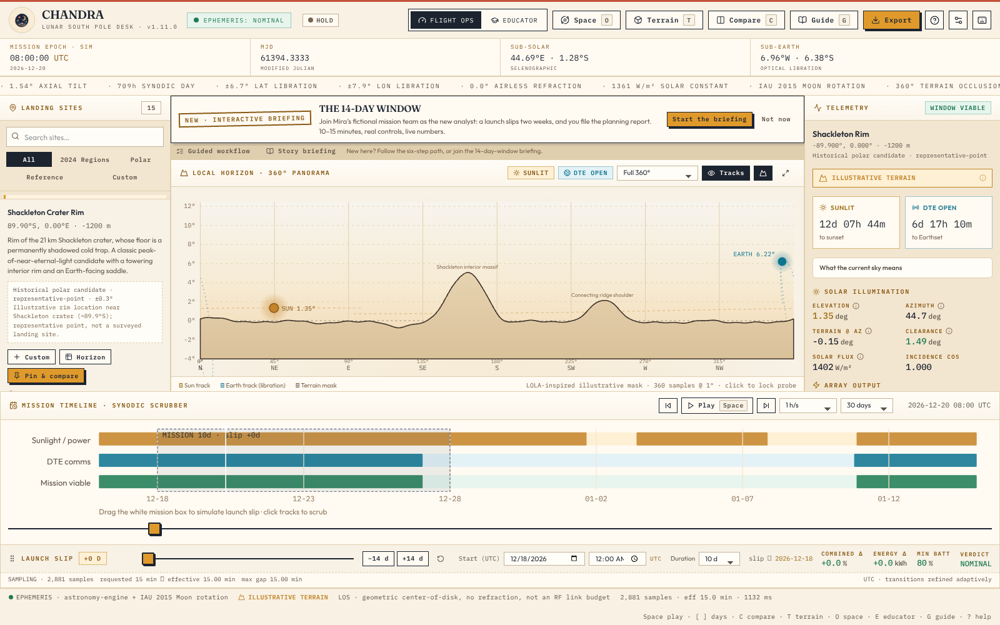
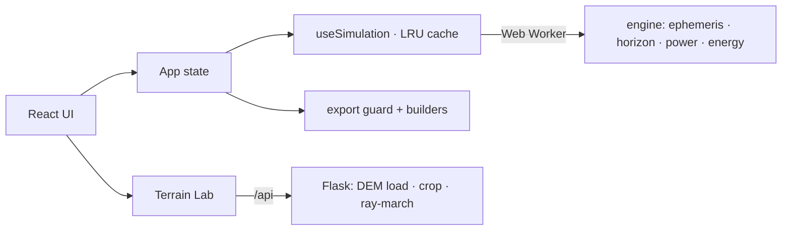

# CHANDRA

Lunar mission planning and analysis workbench.

CHANDRA evaluates candidate landing sites near the lunar south pole for a
surface mission: when the Sun clears the local terrain, when Earth is
geometrically visible, what a solar array generates, and whether the battery
energy budget closes over a mission window — including the effect of a launch
slip. It is a browser application (React + TypeScript) with a scientific
engine that runs in a Web Worker, plus an optional Python backend for working
with real lunar elevation models.

The project started as a NASA Space Apps Challenge concept and has since been
rebuilt as an analysis tool with explicit data provenance. It is not a NASA
application, and nothing here is flight software. Every result is labeled with
what the underlying data supports: illustrative terrain, synthetic demo
terrain, and frame-verified DEMs are distinct confidence tiers, and analyses
that fail validation are blocked rather than quietly degraded.



## What it does

- **Candidate sites** — a curated catalogue of polar CLPS/Artemis candidate
  regions (approximate region centers with source and uncertainty, not
  surveyed landing points), historical benchmarks (Apollo 11, Chang'e 4), and
  custom sites from coordinates or editable horizon masks.
- **Sun and Earth geometry** — topocentric directions from astronomy-engine
  with the IAU 2015 Moon body-fixed rotation; optical libration emerges from
  the time-varying frame. Validated against independent SPICE computations.
- **Local horizon analysis** — 360° terrain masks occlude Sun and Earth;
  visibility transitions are refined by bisection below the sample grid.
- **Terrain import** — load real lunar DEMs (GeoTIFF) through the Python
  backend, inspect them in 3D, ray-march a horizon mask, and import it into
  the planner with samples preserved verbatim. Frame validation is an explicit
  allowlist; unknown frames are blocked from quantitative use.
- **Mission windows** — scrub time, set a UTC start and duration, drag a
  launch slip of up to 60 days, and compare baseline vs slipped windows.
- **Power and battery** — cosine-incidence solar generation (horizontal deck
  or vertical mast), event-aware adaptive-Simpson energy integration with
  charge/discharge efficiencies and SOC limits.
- **Communication visibility** — geometric Earth line-of-sight with a
  configurable margin. This is not an RF link budget.
- **Scenario comparison** — pin up to four site/date/configuration scenarios;
  ranking never mixes data-confidence tiers.
- **Reproducible exports** — JSON mission report and five CSVs (summary,
  telemetry, energy history, visibility events, horizon mask). Every file
  carries the app version, report schema version, a SHA-256 analysis
  fingerprint, the effective (sanitized) configuration, and per-row
  provenance. See [scientific-method.md §13](docs/scientific-method.md).
- **Tutorial and educational views** — a nine-chapter interactive briefing
  that drives the real planner, an educator mode, a glossary, and 3D Space
  views (planet time-lapse, stylized vehicle hangar).

## Installation

Prerequisites: Node.js 22+ and npm. Python 3.11+ is optional — only needed for
the real-DEM backend and the Python test suite.

```bash
git clone https://github.com/Hemansh2633B/chandra.git
cd chandra
npm ci
npm run dev          # http://localhost:5173
```

> The GitHub repository rename to `chandra` is pending an owner action; until
> it completes, clone from
> `https://github.com/Hemansh2633B/Clps-lunar-mission.git`. The old URL will
> redirect after the rename.

The frontend works standalone: Terrain Lab offers a clearly labeled synthetic
demo when the backend is offline, and real mode reports an actionable error
instead of substituting data.

Full stack with the DEM backend:

```bash
python3 -m venv .venv
.venv/bin/python -m pip install -r requirements-dev.txt
npm run dev:full     # Flask terrain API on :8000 + Vite on :5173
```

To use a real DEM, copy `dem_config.example.json` to `dem_config.json`, fill
in values verified from the product label (frame, datum, units — unfilled
templates are rejected), and pass `npm run dev:full -- --dem-config dem_config.json`.
See [data/README.md](data/README.md) for supported formats and sources.

Production build:

```bash
npm run build        # tsc + vite build → dist/
npm run preview
```

## Tests

```bash
npm run typecheck    # tsc, strict
npm test             # Vitest unit suites (engine, exports, session, tutorial)
npm run test:geometry  # Three.js geometry checks
npm run test:parity    # TypeScript ↔ Python horizon ray-marcher parity
npm run test:python    # pytest (DEM loading, crops, API, frames)
```

Browser E2E suites need the full stack running (`npm run dev:full`) in another
terminal:

```bash
npm run test:browser   # planner, Terrain Lab, Space views, mobile
npm run test:story     # interactive briefing, personas A–E
npm run test:exports   # scientific exports, personas A–E
```

Python tests gated on SPICE kernels skip (and report as skipped) when kernels
are absent. The CI `spice-validation` job fetches checksummed kernel mirrors
and runs them for real. `npm run test:real-dem` additionally requires the
verification fixture described in [verification.md](docs/verification.md).

CI (`.github/workflows/ci.yml`) runs three jobs: quality (typecheck, build,
unit, geometry, parity, Python), browser E2E (all three Playwright suites),
and independent SPICE validation. See [ci-governance.md](docs/ci-governance.md).

## Architecture



Window simulations run in a dedicated Web Worker with a 36-entry LRU cache;
results are keyed to the exact input identity, and the export guard re-checks
that identity before any download. The backend is optional and only serves
DEM extraction and horizon computation — all mission science runs client-side.

Component responsibilities and data flow: [docs/architecture/overview.md](docs/architecture/overview.md).

```
├── src/            # React app: components, engine, terrain, tutorial, exports
├── backend/        # Flask DEM API (Rasterio/GDAL, PyProj)
├── tests/          # Vitest + pytest suites, SPICE reference data
├── scripts/        # dev orchestration, E2E suites, parity/geometry checks
├── docs/           # method, verification, accessibility, architecture, history
├── data/           # local DEM drop zone (rasters git-ignored)
└── public/assets/  # imagery with provenance records
```

## Scientific assumptions and limitations

These boundaries are enforced in code and disclosed in every export. They are
not negotiable presentation details.

- **Horizons are local.** Terrain masks describe the terrain around the
  landing point (DEM crops span 0.5–20 km). There is no regional
  distant-horizon model; every output is labeled `LOCAL`.
- **The ME/PA frame correction is a planning-grade constant.** DEMs declared
  in MOON_ME / MOON_PA (DE421) are rotated into the IAU 2015 ephemeris frame
  with a constant correction whose residual (≤0.0039°) was validated against
  SPICE for 2020–2035 only. Analyses outside that range are blocked. Unknown
  frames are blocked outright.
- **Earth visibility is geometric line-of-sight**, center-of-disk, with no
  antenna patterns, terrain diffraction, or link margins. It is not an RF
  link budget and does not establish communications availability.
- **The energy model is an energy balance**, not spacecraft survival. It says
  nothing about thermal limits, radiation, or hardware reliability.
- **The feasibility score is application-defined.** It weights visibility,
  illumination, DTE and energy in a disclosed heuristic. It is not a NASA
  methodology or metric.
- **Catalogue coordinates are approximate region centers** from published
  Artemis candidate-region announcements, with per-site uncertainty. They are
  not surveyed landing coordinates.
- **Illustrative terrain is not measured terrain.** Curated and custom-site
  masks are LOLA-inspired illustrations; the synthetic DEM demo is procedural.
  Only imported, frame-verified DEM data is labeled measured, and it stays
  planning-grade.

Full method, validation evidence and error analysis:
[docs/scientific-method.md](docs/scientific-method.md).

## Project status

Current release: **1.10.0** (scientific exports, reproducibility and session
integrity). The unit, geometry, parity, Python, and all three browser E2E
suites pass; executed evidence per release is recorded in
[docs/verification.md](docs/verification.md). The real-DEM browser test runs
only when its fixture is present and is reported as not run otherwise.
Manual screen-reader testing (NVDA/VoiceOver) has not been executed; the
checklist in [docs/accessibility.md](docs/accessibility.md) is explicit about
that.

Open engineering findings (analysis-identity rounding, session size cap,
coarse-resolution disclosure) are tracked in [docs/known-issues.md](docs/known-issues.md).

Release history and implementation reports:
[docs/implementation-history/](docs/implementation-history/).

## Contributing

Work on a feature branch, keep changes scoped, and run the test suites above
before opening a pull request against `main`. Scientific changes need
validation evidence (unit tests against the SPICE reference, parity checks,
or documented reasoning), not just passing UI tests. Documentation claims
must match executed verification — do not document a check as passed without
running it. There is no CLA.

## License

Application code: MIT. Bundled LROC imagery is credited to NASA/GSFC/ASU and
used for scientific/educational visualization; asset provenance is recorded in
[public/assets/PROVENANCE.md](public/assets/PROVENANCE.md).
