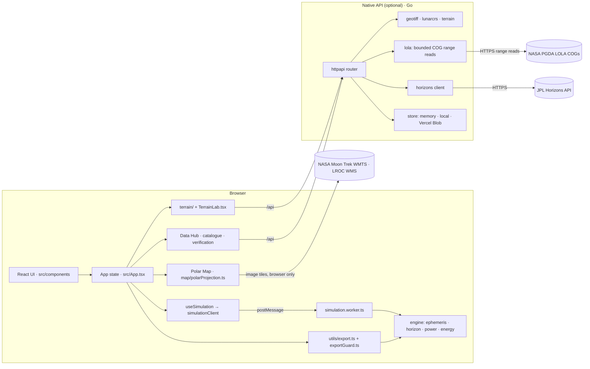

# Architecture

This document describes CHANDRA as implemented in the far-side analysis upgrade (v1.13-era work on top of the v1.12 codebase). For the scientific
method and its validation evidence, see
[scientific-method.md](../scientific-method.md); for what was executed and what
was not, see [verification.md](../verification.md); for the original (obsolete)
hackathon design sketch, see [hackathon-sketch.md](hackathon-sketch.md).

## Components

Three properties hold everywhere in this diagram:

- **All mission science runs in the browser.** The API never computes
  visibility, power or energy; it serves terrain, provenance and an independent
  ephemeris reference.
- **The API is optional.** Without it the console still works: the catalogue
  and the recorded Horizons comparison are bundled, the Terrain Lab offers its
  labelled synthetic demo, and every live feature states why it is unavailable
  instead of substituting data.
- **Imagery is never terrain.** Map tiles go from the provider straight to
  `` elements in the browser. They are not read back, not sent to the API
  and never used as elevation.

## Frontend (`src/`)

- `App.tsx` owns the workspace state: selected site, UTC baseline, mission
  config, launch slip, pinned scenarios, view mode. There is no router; views
  (planner, comparison, Terrain Lab, Space, Data Hub) are mutually exclusive
  state switches. The Data Hub view is session-local and is not part of the
  persisted workspace.
- `components/` — the planner panels (horizon panorama, polar map, timeline,
  telemetry), comparison matrix, settings/custom-site modals, onboarding,
  workflow guide, Terrain Lab, Space viewers, and the v1.12 additions:
  `DataHub.tsx` (source catalogue, CSA references), `VerificationPanel.tsx`
  (Horizons comparison), `TerrainDataPanel.tsx` (datasets, raster metadata,
  LOLA acquisition).
- `hooks/useSimulation.ts` — the React binding for window simulation results.
  Returns cached-or-null for the active `simulationKey`, never a stale result.
  The underlying `engine/simulationClient.ts` owns the 36-entry LRU cache,
  in-flight deduplication, reference counting and cancellation (worker
  terminate/respawn, debounced 40 ms) when no consumer wants a result.
- `engine/` — the scientific core, shared by the worker and the main thread:
  - `ephemeris.ts`: Sun/Earth topocentric directions from astronomy-engine with
    the IAU 2015 Moon body-fixed rotation, light-time and aberration corrections.
  - `horizonPhysics.ts`: local terrain-mask occlusion, spherical-limb floor,
    adaptive Sun/Earth transitions and their refinement/fallback diagnostics.
  - `occultation.ts` / `vectors.ts`: finite-disk target-vs-lunar-limb overlap,
    exact ray/sphere segment tests and frame-labelled 3-vectors.
  - `incidence.ts`: DEM-derived local normal and solar incidence; unavailable
    slope is not coerced to a flat measurement.
  - `relay.ts`: deterministic circular-lunar, parametric L2 and fixed-body
    relay-state proxies; two LOS legs remain separate and labelled geometry.
  - `powerComms.ts`: cosine-incidence solar power, direct Earth LOS and
    summary/window assembly (direct DTE is not replaced by relay visibility).
  - `integration.ts`: event-partitioned adaptive-Simpson energy integration
    with battery efficiencies, SOC saturation and depletion interpolation;
    records its own accepted-boundary history for export.
  - `simulation.ts`: sampling (20,000-sample cap, uniform coarsening),
    `simulationKey` identity, summary assembly.
  - `canonicalJson.ts`: deterministic full-precision serialization for the
    exact analysis identity.
  - `simulation.worker.ts` / `simulationClient.ts`: worker protocol with phase
    progress and request cancellation.
  - `analysisStatus.ts`, `lunarFrame.ts`: the computation-boundary gate, the
    frame allowlist (MOON_ME / MOON_PA DE421 constant correction, IAU 2015),
    forward and inverse site conversion, and the shared
    `ENERGY_RESOLUTION_COARSE` disclosure helper.
- `map/polarProjection.ts` — the south polar stereographic projection used by
  the Polar Map and by the Moon Trek tile grid (sphere R = 1 737 400 m, true
  scale at the pole, 0° meridian up, 90°E right). One module projects the
  graticule, the site markers and the tile corners, so they cannot drift apart.
- `data/catalogue.ts` — typed access to the source catalogue
  (`backend/catalog/catalogue.json`, imported at build time so the browser and
  the API ship the same document), the map-layer subset and the external
  viewer links.
- `verification/` — `horizons.ts` compares engine output with a Horizons
  observer table; `recordedHorizons.json` is a recorded reference that makes
  the comparison work offline and on static hosting.
- `terrain/` — Terrain Lab client: API calls with typed capability and error
  handling (`api.ts`), dataset selection (`datasets.ts`), coordinate
  conversions, Three.js mesh/lighting, horizon ray-marching (mirrors
  `backend/terrain/horizon.go`; parity is tested), mission-profile import.
- `tutorial/` — THE 14-DAY WINDOW briefing: chapter structure, live narration
  from engine results, objective witnesses, versioned session persistence with
  an 800,000-character cap.
- `utils/export.ts` / `exportGuard.ts` — all six export kinds. Builders are
  async (SHA-256 analysis fingerprint over the exact canonical key); the guard
  enforces result identity via the same `simulationKey` before any download.
  Report schema 2.1.0 adds a `dataProvenance` block; see scientific-method §13.

## Native API (`backend/`, `api/`, `cmd/`)

The API is a single Go module (`chandra`) that uses **only the Go standard
library**. `backend/httpapi` exposes one `http.Handler`; `cmd/chandra-api` wraps
it in a local server and `api/index.go` wraps the same handler as one Vercel
function, so the two cannot diverge.

| Package | Responsibility |
|---|---|
| `backend/geotiff` | Single-band GeoTIFF and BigTIFF reader (both byte orders; strips and tiles; uncompressed, LZW, Deflate, PackBits; horizontal and floating-point predictors; 8/16/32/64-bit unsigned and signed integers and IEEE floats; GeoTIFF keys, GDAL NoData and metadata) and a subset writer. Reads through `io.ReaderAt`, so the same code reads a local file and a remote COG by byte range. Anything outside this list is refused with an explicit error. |
| `backend/lunarcrs` | The closed set of lunar coordinate systems the project accepts — geographic, polar stereographic, oblique stereographic, azimuthal equidistant, equirectangular — on a sphere, with exact forward/inverse formulas and strict validation (radius near 1 737.4 km, zero reference meridian, no Earth CRS). |
| `backend/terrain` | DEM configuration and validation, landing-centred bilinear extraction (0.5–20 km, 129/257/513 grids, exact centre vertex, NoData preserved), the synthetic demo grid and the 360° horizon ray-marcher. |
| `backend/frames` | Body-fixed frame allowlist and the constant ME/PA → IAU 2015 site conversion (same constants as `src/engine/lunarFrameData.ts`). |
| `backend/horizons` | JPL Horizons client: fixed endpoint, validated inputs, observer-table parser, response cache, minimum request interval, terse upstream errors. |
| `backend/lola` | Bounded acquisition of NASA PGDA LOLA polar DEM subsets by HTTP range reads of the official COGs: five allowlisted products, one allowlisted host, byte and request budgets, samples copied without resampling. |
| `backend/store` | Dataset storage adapters: in-memory, local directory, Vercel Blob. |
| `backend/catalog` | The embedded source catalogue and its consistency tests, including the bundled-basemap orientation check. |
| `backend/httpapi` | Routing, input limits, per-route rate limits and timeouts, a concurrency bound for heavy routes, uniform JSON errors, optional static file serving. |
| `cmd/chandra-api` | Local server (`--dem`, `--dem-config`, `--host`, `--port`, `--static`). |
| `cmd/chandra-lola` | Command-line LOLA subset downloader. |
| `cmd/chandra-fixture` | Fetches the third-party software verification fixture. |
| `cmd/chandra-horizon` | Horizon computation for the TypeScript ↔ Go parity check. |

Routes (authoritative list: `backend/httpapi/server.go`):

| Route | Purpose |
|---|---|
| `GET /api/health`, `GET /api/config`, `GET /api/examples` | Liveness, capabilities and conventions. Unchanged from v1.11 apart from additive fields. |
| `POST /api/terrain`, `POST /api/horizon` | Terrain grid and 360° horizon for a site. Unchanged contract; optional `dataset_id`. |
| `GET /api/sources` | The source catalogue plus the runtime's capabilities. |
| `GET /api/datasets` | Configured and acquired DEMs and the acquirable products. |
| `GET /api/terrain/metadata` | Raster header, CRS, georeferencing and declared provenance for one dataset. |
| `POST /api/terrain/acquire` | Plan (`dry_run`) or perform a bounded LOLA subset download. |
| `POST /api/ephemeris/verify` | Fetch a JPL Horizons observer table for a MOON_ME surface site. |

Errors are JSON with a human-readable `error` and, where a client must branch,
a stable `code`: 400 invalid input, 404/405, 413 oversized body, 429 with
`Retry-After`, 502 `horizons_upstream`, 503 `horizons_disabled` /
`acquisition_disabled`, 500 with no internal detail.

### Why the backend is native Go, and why not Rust

v1.11 shipped a Python backend (Flask, Rasterio/GDAL, PyProj). It could not be
deployed as a Vercel function in a useful form: GDAL and PROJ are large native
libraries, and the request was for a native-language backend that deploys with
the console. Go and Rust were the two candidates.

| Criterion | Go | Rust |
|---|---|---|
| Vercel runtime | Official `@vercel/go`, labelled Beta in Vercel's documentation when checked on 2026-11-14 | Official Rust runtime, also labelled Beta on the same date |
| Built and tested for this project | Yes — compiled, unit-tested and run as a Vercel build output locally | **No.** The Rust toolchain and crates could not be downloaded in the development sandbox, so no Rust code was compiled or measured |
| Dependencies needed | None beyond the standard library (HTTP client and server, JSON, Deflate, SHA-256) | Would need crates for HTTP, JSON and compression; no standard-library HTTP |
| GDAL / PROJ | Not available as a pure-Go library | Not available as a pure-Rust library either; the mature option is a binding to the same C libraries |
| Raster decoding speed | Adequate here: an acquisition is capped at 16 million pixels and a terrain request resamples a 513 × 513 grid at most | Likely faster for decode-heavy work; not measured |
| One handler for local server and function | Yes (`net/http`) | Possible with an adapter crate |

Go was chosen because it was the option that could be **built, tested and
validated end to end**, and because a standard-library-only backend removes
supply-chain and packaging risk from the deployment. This is an engineering
decision made under a real constraint, not a benchmark result: nothing here
shows Go to be faster or better than Rust, and Rust remains a reasonable choice
if decode throughput ever dominates.

Neither language offers GDAL or PROJ natively, so the consequence of *either*
choice is the same and is the part that matters scientifically: GeoTIFF reading
and map projection are implemented in this repository for a **closed, validated
set** of formats and coordinate systems, and anything outside that set is
refused rather than approximated. The implementation is checked against
GDAL 3.10.3 / PROJ 9.5.1 output recorded from the v1.11 Python backend; see
[scientific-method.md §14](../scientific-method.md) and
[verification.md](../verification.md).

What remains in Python: nothing at runtime. `tools/spice-evidence/` is an
isolated, optional tool that regenerates the SPICE frame evidence; the
application, its tests and its deployment do not need it.

## Data flows

### Mission analysis (unchanged)

1. UI changes site/config/window → `useSimulation` computes `simulationKey`.
2. Cache hit → result returned synchronously. Miss → worker request
   (deduplicated if already in flight).
3. Worker samples the window, refines visibility transitions by bisection,
   integrates energy between refined events, assembles the summary and
   `energyHistory`, posts progress and the result.
4. `analysisStatus` gates the result (frame verified? coverage complete? epoch
   inside the validated 2020–2035 range?). Blocked results carry sky geometry
   only — no visibility verdicts, no exports.
5. Exports re-verify identity through `exportGuard` and embed provenance,
   effective config and disclosures in every file.

### Polar Map imagery

1. The map always draws the bundled LROC WAC mosaic first.
2. If a remote layer is selected, `polarProjection.ts` computes which WMTS
   tiles (Moon Trek) or which single GetMap image (LROC WMS) cover the view and
   where each must sit. The browser requests them as images.
3. Each tile reports load or failure. The status line reads *Loading*, *Live*,
   *Partly loaded* or *Unavailable — showing bundled imagery*; the bundled
   mosaic stays underneath, so a provider outage never blanks the map.
4. Graticule, terminator shading and site markers are drawn on a canvas above
   the imagery using the same projection.

### Independent ephemeris check

1. The Data Hub converts the selected site from IAU 2015 to MOON_ME (Horizons'
   lunar surface frame) with the inverse of the project's constant correction.
2. `POST /api/ephemeris/verify` requests Sun and Earth observer tables from JPL
   Horizons for that site and time span.
3. The browser recomputes the same instants with the engine, removes the known
   azimuth offset between the two frames, and reports the largest differences
   against fixed tolerances.
4. Without the API, the same comparison runs against the bundled recording and
   is labelled as recorded, with its retrieval date.

### LOLA terrain acquisition

1. The Terrain Lab asks for a plan (`dry_run`): the API reads only the remote
   COG header and reports the pixel window, the encoded size and the number of
   blocks. Nothing is downloaded yet.
2. On confirmation the API range-reads exactly the blocks that cover the
   window, writes a subset GeoTIFF with the source samples, CRS and NoData
   unchanged, records a SHA-256 and a provenance document, and stores both.
3. The dataset then behaves like a configured DEM: the Terrain Lab can inspect
   its metadata, extract terrain and compute a horizon from it.

## Deployment topologies

| Topology | What runs | Live features |
|---|---|---|
| Static hosting only | `dist/` | Planner, catalogue, recorded verification, synthetic Terrain Lab demo, remote imagery layers |
| Local full stack | `npm run dev:full` (Go API on 8000, Vite on 5173), or `chandra-api --static dist` as one process | Everything, with datasets stored in `data/acquired/` |
| Vercel | Static console + one Go function for `/api/*` | Everything; acquired datasets persist only when a Vercel Blob store is connected (see [deployment/vercel.md](../deployment/vercel.md)) |

## Security boundaries

- The API's default raster provider is `pgda.gsfc.nasa.gov` (five built-in
  south-polar LOLA products); Horizons uses `ssd.jpl.nasa.gov`. A deployment
  operator may add specific PDS Geosciences Node products through
  `CHANDRA_LOLA_PRODUCTS_JSON`, but the manifest is host-allowlisted and its
  metadata is validated; a browser/client can never supply a URL. Test hooks
  (`CHANDRA_LOLA_BASE_URL`, `CHANDRA_HORIZONS_BASE_URL`) accept only the
  official hosts or a loopback address. When Vercel Blob storage is configured
  the API also talks to the Vercel Blob service, and only to it.
- Request bodies are size-limited, numeric inputs are range-checked, heavy
  routes share a concurrency bound and each route has a time limit. Rate limits
  are per client and per instance; on a serverless platform they are a courtesy
  limit, not a quota.
- Upstream and internal errors are reported without hostnames, paths, tokens
  or stack traces.
- The static console is served with a Content-Security-Policy that allows
  images from the two imagery hosts and network requests to its own origin
  only; no third-party script is loaded.
- The only secret the API can use is the Vercel Blob token, read from the
  environment and never returned in a response.

## Tests (`tests/`, `backend/**/_test.go`, `scripts/`)

- `tests/*.test.ts` — Vitest unit suites (engine, ephemeris vs SPICE reference,
  frames, sampling, energy, exports, session validation, tutorial, a11y
  wording, polar projection, Horizons comparison, Data Hub catalogue).
- `backend/**/*_test.go` — Go tests: reader and projection parity with recorded
  GDAL/PROJ output, extraction and horizon parity with the former Python
  backend, replay of recorded v1.11 API responses, Horizons parsing against
  recorded responses, LOLA acquisition against a loopback COG server, storage
  adapters, catalogue consistency, HTTP limits and error shapes.
- `tests/golden/` — the recorded reference: rasters written by GDAL and JSON
  captured from the v1.11 Python backend, with the generator kept for
  provenance.
- `scripts/browser-test.mjs`, `story-browser-test.mjs`,
  `export-browser-test.mjs` — Playwright E2E personas against a live dev stack.
- `scripts/datahub-browser-test.mjs` — self-contained E2E for the v1.12 data
  features: it starts its own loopback fixture servers and the real API binary
  and intercepts the imagery hosts, so it needs no external network.
- `scripts/real-dem-browser-test.mjs` + `.github/workflows/real-dem-fixture.yml`
  — optional software-only smoke against the third-party gap-filled
  verification downsample (not a required check, not a science product).
- `scripts/vercel-check.mjs` — validates the Vercel configuration and, with
  `--built`, executes the built function locally. It does not prove a live
  deployment.
- `scripts/geometry-check.ts`, `horizon-parity.ts` — Three.js geometry and
  TypeScript ↔ Go ray-marcher parity.
- `tools/spice-evidence/` — optional Python tests for the SPICE evidence
  generator (kernel-gated).

## Product surface (proposed, not implemented)

The current app has no router; `/` is the workspace. A landing page at `/` and
a lazy workspace at `/workspace`, soft first-run site picker and progressive
scientific-details disclosure are specified in
[../product-design.md](../product-design.md). That document is a design
deliverable, not a claim of shipped routes.
