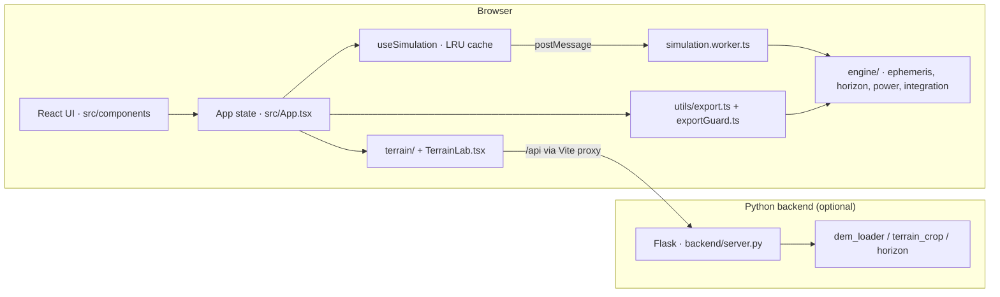

# Architecture

This document describes CHANDRA as implemented. For the scientific method and
its validation evidence, see [scientific-method.md](../scientific-method.md);
for the original (obsolete) hackathon design sketch, see
[hackathon-sketch.md](hackathon-sketch.md).

## Components

### Frontend (`src/`)

- `App.tsx` owns the workspace state: selected site, UTC baseline, mission
  config, launch slip, pinned scenarios, view mode. There is no router; views
  (planner, comparison, Terrain Lab, Space) are state switches.
- `components/` — the planner panels (horizon panorama, polar map, timeline,
  telemetry), comparison matrix, settings/custom-site modals, onboarding,
  workflow guide, Terrain Lab and Space viewers.
- `hooks/useSimulation.ts` — the React binding for window simulation results.
  Returns cached-or-null for the active `simulationKey`, never a stale result.
  The underlying `engine/simulationClient.ts` owns the 36-entry LRU cache,
  in-flight deduplication, reference counting and cancellation (worker
  terminate/respawn, debounced 40 ms) when no consumer wants a result.
- `engine/` — the scientific core, shared by the worker and the main thread:
  - `ephemeris.ts`: Sun/Earth topocentric directions from astronomy-engine with
    the IAU 2015 Moon body-fixed rotation, light-time and aberration corrections.
  - `horizonPhysics.ts`: terrain-mask occlusion, custom-site synthesis,
    DEM-derived profiles.
  - `powerComms.ts`: cosine-incidence solar power, geometric Earth LOS.
  - `integration.ts`: event-partitioned adaptive-Simpson energy integration
    with battery efficiencies, SOC saturation and depletion interpolation;
    records its own accepted-boundary history for export.
  - `simulation.ts`: sampling (20,000-sample cap, uniform coarsening),
    `simulationKey` identity, summary assembly.
  - `simulation.worker.ts` / `simulationClient.ts`: worker protocol with phase
    progress and request cancellation.
  - `analysisStatus.ts`, `lunarFrame.ts`: the computation-boundary gate and the
    frame allowlist (MOON_ME / MOON_PA DE421 constant correction, IAU 2015).
- `terrain/` — Terrain Lab client: DEM API calls, coordinate conversions,
  Three.js mesh/lighting, horizon ray-marching (mirrors `backend/horizon.py`;
  parity is unit-tested), mission-profile import.
- `tutorial/` — THE 14-DAY WINDOW briefing: static chapter structure
  (`story.ts`), live narration from engine results (`narrative.ts`), objective
  witnesses (`witnesses.ts`), versioned session persistence (`session.ts`).
- `utils/export.ts` / `exportGuard.ts` — all six export kinds. Builders are
  async (SHA-256 analysis fingerprint); the guard enforces result identity via
  `simulationKey` before any download. See scientific-method §13.
- `data/` — the site catalogue (with per-site provenance), mission presets
  (illustrative), glossary and guided scenarios.

### Backend (`backend/`, optional)

Flask API for real DEM work. The frontend runs fully without it; Terrain Lab
then offers a labeled built-in synthetic demo, and real mode reports an
actionable no-DEM error instead of substituting data.

- `server.py` — routes: `GET /api/health`, `GET /api/config`,
  `GET /api/examples`, `POST /api/terrain`, `POST /api/horizon`.
- `dem_loader.py` / `config.py` — Rasterio/GDAL loading with strict lunar CRS,
  datum, frame and unit validation; unfilled template values are rejected.
- `terrain_crop.py` — bounded bilinear landing-centered extraction
  (0.5–20 km, 129/257/513 grids, exact center vertex, NoData preserved).
- `horizon.py` — 360° ray-marched horizon with per-ray coverage and a disclosed
  edge inset; TypeScript counterpart in `src/terrain/horizon.ts`.
- `lunar_frame.py` — SPICE-backed frame classification (kernel-gated tests).
- `synthetic.py` — the labeled synthetic demo grid.
- `download_lola_subset.py` — optional NASA LOLA COG subset downloader with
  range reads, provenance JSON and SHA-256.

### Data flow for a mission analysis

1. UI changes site/config/window → `useSimulation` computes `simulationKey`.
2. Cache hit → result returned synchronously. Miss → worker request
   (deduplicated if already in flight).
3. Worker samples the window, refines visibility transitions by bisection,
   integrates energy between refined events, assembles the summary and
   `energyHistory`, posts progress and the result.
4. `analysisStatus` gates the result (frame verified? coverage complete? epoch
   inside the validated 2020–2035 range?). Blocked results carry sky geometry
   only — no visibility verdicts, no exports.
5. Exports re-verify identity through `exportGuard` and embed provenance,
   effective config and disclosures in every file.

### Tests (`tests/`, `scripts/`)

- `tests/*.test.ts` — Vitest unit suites (engine, ephemeris vs SPICE reference,
  frames, sampling, energy, exports, session validation, tutorial, a11y wording).
- `tests/python/` — pytest (DEM loading, crops, API errors, horizon, frames).
- `scripts/browser-test.mjs`, `story-browser-test.mjs`,
  `export-browser-test.mjs` — Playwright E2E personas against a live dev stack.
- `scripts/geometry-check.ts`, `horizon-parity.ts` — Three.js geometry and
  TS↔Python ray-marcher parity.
