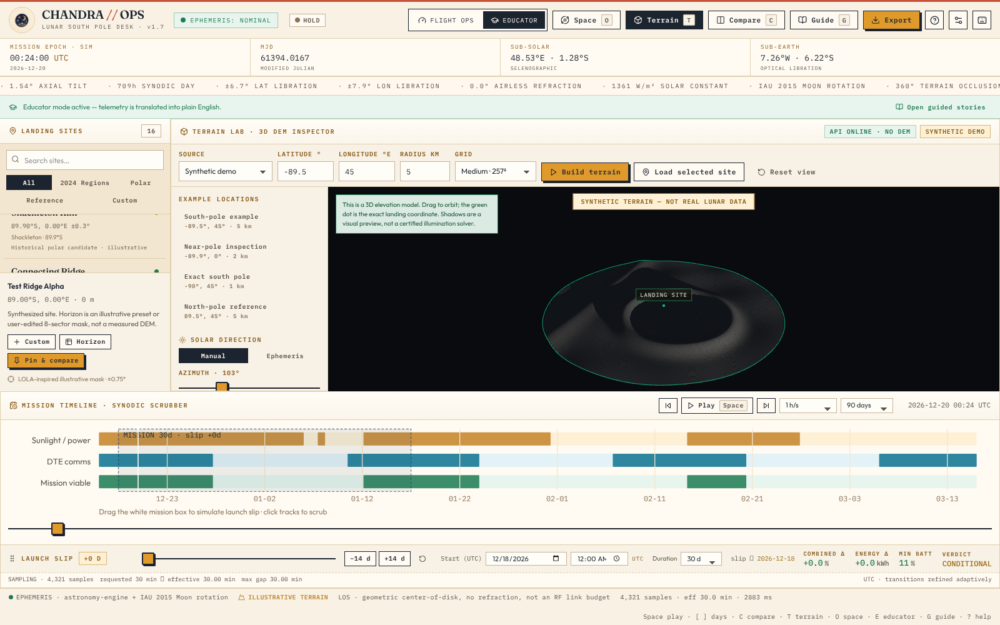
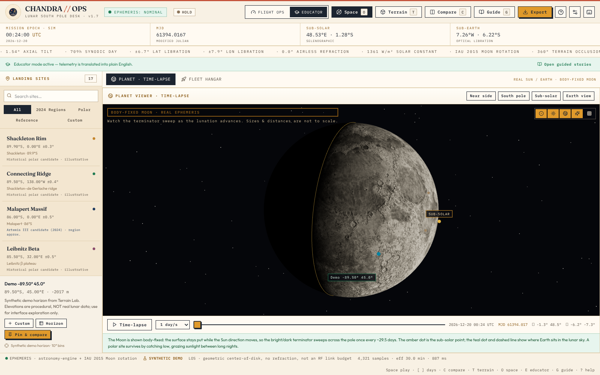
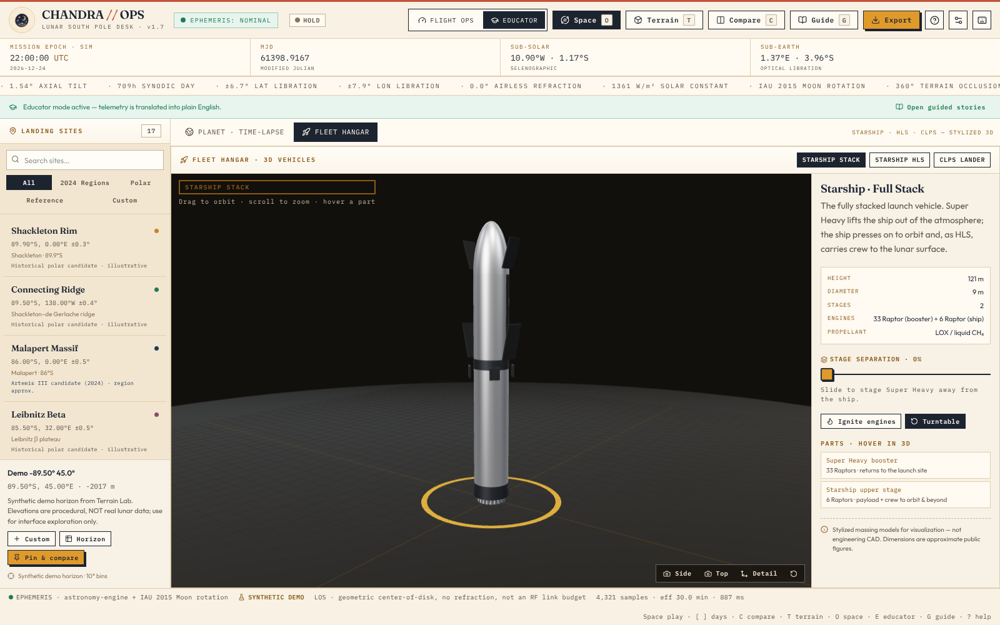

# CHANDRA // OPS · Lunar South Pole Mission Planning Console

An interactive, production-grade workspace for comparing **solar illumination**, **terrain occlusion**, and **Direct-to-Earth (DTE) communication** windows at lunar south-pole landing sites — built for the CLPS / Artemis launch-slip trade study.

The app boots into a mission-operations workspace after a short, dismissible first-run welcome that offers an explicit choice between a labeled demo and configuring real DEM data (never a silent synthetic substitution). A guided six-step workflow — region → UTC date → mission preset → plain-language results → comparison → report — is available from demo mode and a workspace launcher. There is no marketing page. Every panel is live: scrub time, drag the mission window to simulate launch delay, pin up to four site + date + array scenarios, and export CSV / JSON reports.


---

## Quick start

```bash
cd "final draft 1"
npm install
npm run dev          # http://localhost:5173  (binds 0.0.0.0)
```

Optional full stack with the real-DEM Terrain Lab backend:

```bash
python3 -m venv .venv
.venv/bin/python -m pip install -r backend/requirements.txt -r requirements-dev.txt
npm run dev:full     # Flask terrain API on :8000 + Vite console on :5173
# Alternate ports / DEM:
npm run dev:full -- --api-port 8002 --web-port 5174 --dem-config data/verification/lola_verification_config.json
```

`dev:full` forwards `--dem` / `--dem-config` to Flask and points Vite’s `/api` proxy at the chosen API port. `npm run dev:api -- --port 8001` also works; set `CHANDRA_API_PORT=8001` for a separately started Vite dev/preview server.

`npm run dev` alone still works: the mission console is fully functional, and Terrain Lab falls back to a clearly labeled built-in synthetic demo when the API is offline. Real DEM mode requires the backend and never silently falls back.

Production build and checks:

```bash
npm run build        # tsc + vite build
npm test             # 192 Vitest tests (20 files): engine, SPICE-reference ephemeris validation, frame allowlist, transition stress, event-aware energy, analysis status, sampling/battery, catalogue, presets, explanations, UTC, workflow, simulation client, export integrity, DEM-profile, vehicles, story chapters/progress/narrative
npm run test:python  # 92 passed + 4 skipped: backend/DEM/horizon/downloader/API-error/lunar-frame tests.
                     # The 4 skips are SPICE-kernel-gated (kernels not fetched) — SKIPPED, never counted as passed.
npm run test:geometry# Three.js geometry / synthetic / horizon checks
npm run test:parity  # TypeScript ↔ Python horizon ray-marcher parity
npm run test:browser # Playwright console + Terrain Lab + Space views E2E (incl. mobile)
npm run test:story   # Playwright THE 14-DAY WINDOW briefing E2E — personas A–E (beginner, student, returning, invalid-data, mobile/reduced-motion)
npm run test:all     # unit + python + geometry + parity
npm run typecheck
```

Optional real-DEM verification fixture (small public LOLA-derived grid; **software verification only**, gap-filled downsample):

```bash
.venv/bin/python scripts/fetch-lola-verification-fixture.py
npm run build
.venv/bin/python -m backend.server --dem-config data/verification/lola_verification_config.json --port 8001
npm run test:real-dem   # in another terminal; tests http://localhost:8001
```

Continuous integration (`.github/workflows/ci.yml`, repo root): a **quality** job runs
typecheck, build, unit, geometry, parity and pytest on every push/PR (kernel-gated SPICE
tests are reported as SKIPPED, never passed); an optional **spice-validation** job fetches
checksummed GitHub-mirror kernels and runs the real independent SPICE frame tests; a
**browser** job runs the Playwright E2E against a live dev server + terrain API.

> Paths contain a space (`final draft 1`). Always quote them in shell commands.

The dev server is configured with `allowedHosts: true` so it works behind Arena / e2b preview proxies.

---

## Scientific integrity (audit)

This console was audited end-to-end for scientific and engineering correctness. The full
method, validation evidence, and limitations are in **[docs/SCIENTIFIC_METHOD.md](docs/SCIENTIFIC_METHOD.md)**.
Highlights:

- **Reference frames never mixed silently.** The ephemeris uses IAU 2015; LOLA DEMs are
  MOON_ME (DE421). A SPICE-verified constant correction (residual ≤0.0039°, disclosed) rotates
  recognized frames into IAU. **Unrecognized frames are blocked from quantitative mission
  visibility** (viewable in Terrain Lab only). See `backend/lunar_frame.py`,
  `scripts/generate-frame-constants.py`, `src/engine/lunarFrame.ts`.
- **Independent SPICE validation** of Sun/Earth az+el, sub-Earth/sub-solar points, and the IAU
  frame across 9 epochs × 6 sites (incl. exact pole): max errors ≤0.007° (`tests/ephemeris-validation.test.ts`).
- **Correct sampling**: the 20,000-sample cap coarsens the step *uniformly* (full span + both
  endpoints preserved, effective step reported); transitions are refined adaptively; percentages
  and gaps integrate refined crossings and converge.
- **Honest labels**: geometric Earth line-of-sight ≠ RF link budget; instantaneous power ≠ net
  energy; battery energy-balance ≠ thermal survival; the feasibility score is a disclosed
  application-defined heuristic, and data confidence is separated from performance.
- **Persistent provenance indicator** reflects the real computation state (synthetic demo /
  illustrative / real-DEM frame-verified / frame-unverified / incomplete coverage).
- **Catalogue**: the nine Artemis III candidate regions (NASA Oct-2024) as approximate region
  centers with source + uncertainty — never invented precise points; Apollo/Chang'e kept separate.
- **Reproducible exports**: UTC interval, ephemeris/frame, terrain metadata, sampling,
  power/battery assumptions, score methodology, and warnings; exports blocked while computing.

To regenerate the frame constants and validation reference (requires SPICE kernels):

```bash
.venv/bin/python scripts/fetch-spice-kernels.py        # downloads kernels + PROVENANCE.json
.venv/bin/python scripts/generate-frame-constants.py   # writes lunarFrameData.ts + frame-reference.json
```

---

## What you can do

| Capability | Where |
|---|---|
| Browse 7 polar CLPS/Artemis candidates + 3 historical benchmarks | Left site rail |
| Synthesize a custom site from coordinates or by clicking the map | **Custom** button / map click |
| Inspect a 360° terrain silhouette with Sun & Earth tracks | Horizon panorama |
| Lock a probe on the panorama to read azimuth / elevation / terrain | Click the sky plot |
| View a georeferenced LROC south-pole mosaic with lighting + DTE vector | Polar stereographic map |
| Scrub hours → synodic month → 90-day seasons | Timeline + range slider |
| Simulate a 0–60 day launch slip by dragging the mission box | Timeline / slip slider |
| Compare 2–4 pinned scenarios side-by-side | **Compare** (`C`) |
| Switch between Planner telemetry and Educator plain-English | Header mode switch (`E`) |
| Walk guided stories + glossary | **Field guide** (`G`) |
| Join a fictional mission team for a 10–15 min interactive briefing | **Story briefing** launcher / Field Guide card |
| Export mission report, timeseries, horizon mask, comparison | **Export** menu |
| Inspect real/synthetic DEMs in 3D with orbit/pan/zoom | **Terrain Lab** (`T`) |
| Hover/click surface samples, exaggerate relief, toggle shadows | Terrain Lab inspector |
| Ray-march a 360° DEM horizon and send it to the mission planner | Terrain Lab → Compute horizon → Use in mission |
| Preserve DEM horizon samples verbatim in mission sites (no illustrative ripple) | DEM-derived custom sites + Site context provenance |
| Load prototype example locations or the selected mission site | Terrain Lab examples / Load selected site |
| Keyboard-orbit the 3D viewport, top/oblique presets, zoom buttons | Focus canvas: arrows / + / − / Home |
| Watch a 3D Moon with a real-ephemeris terminator sweep in time-lapse | **Space → Planet** (`O`) |
| Fly around stylized Starship / HLS / CLPS vehicles with staging & plumes | **Space → Fleet hangar** (`O`) |

### Keyboard shortcuts

`Space` play/pause · `[` / `]` ±1 day · `←` / `→` ±1 hour · `C` compare · `T` Terrain Lab · `O` Space views · `E` educator · `G` field guide · `P` pin scenario · `?` help · `Esc` close overlays (or pause the story briefing when no overlay is open).

---

## THE 14-DAY WINDOW · interactive mission briefing

A storytelling tutorial that teaches the planner by **using** it. You join a fictional
mission team as the new analyst: **Mira** (operations lead) and **Dr. Arin** (science
specialist) are invented characters, the scenario is illustrative — **not an actual
Artemis or CLPS flight plan** — and every number in the dialogue is computed live by
the same engine the instruments display. The story never scripts a result.

**Nine chapters (~10–15 min):** first shift → pick a region (provenance, region centers
vs surveyed points) → follow the Sun (elevation/azimuth/occlusion) → find Earth
(libration, AOS/LOS, *geometric LOS ≠ RF link budget*) → budget the power (presets are
illustrative assumptions, not NASA vehicle specs) → ride out a +14-day launch slip
(baseline vs slipped window, narrated from the actual simulation — better *or* worse)
→ read the battery report (*energy deficit ≠ thermal survival*) → compare like with
like (confidence tiers, disclosed heuristic) → file the report through the **real,
guarded export** (blocked analyses cannot be exported — that is the lesson).

**How it behaves**

- Compact docked panel (bottom sheet on mobile) with chapter stamps, mission-log UTC,
  dialogue cards, live readouts, a knowledge check per chapter, and *Go deeper*
  formal definitions linked to the canonical glossary.
- A non-blocking spotlight rings the **real** control for each objective; objectives
  complete only when the real app state changes (site selected, time scrubbed, config
  changed, slip moved, two scenarios pinned, a guard-passing export). No fake buttons.
- First-time users get a dismissible suggestion after onboarding; returning users are
  never forced. Start/resume/restart any time from the workspace launcher or the
  Field Guide card. Pause keeps your place; **Exit restores your pre-briefing setup**
  (the training mission snapshots your site/date/config first and says so).
- Progress persists under a versioned key (`chandra-story-v1`); corrupt or foreign
  versions are treated as fresh, never as a crash. Keyboard accessible (focus moves
  to the chapter heading; `Esc` pauses), `prefers-reduced-motion` respected.
- Blocked analyses (unverified frame, incomplete coverage, epoch outside the
  validated frame-model range) produce an **explanation, not a verdict** — in the
  story and in the instruments.

Run its E2E suite with `npm run test:story` (personas A–E; needs `npm run dev:full`).
Implementation evidence: `docs/IMPLEMENTATION_REPORT_v1.8.md`.

---

## Terrain Lab · ported from `prototype/`

The repository’s original prototype has been integrated as **Terrain Lab** (`T`). See [`docs/PROTOTYPE_PORT.md`](docs/PROTOTYPE_PORT.md) for the full feature map.



- **Real DEM backend** — Flask + Rasterio/GDAL + PyProj. Loads single-band lunar GeoTIFF/PDS rasters, validates lunar CRS, spherical radius, vertical datum, units, scale/offset, and body-frame metadata. Extracts a bounded, bilinear, landing-centered grid (0.5–20 km; 129/257/513 samples). NoData remains a gap.
- **Synthetic demo** — available from the backend and as a built-in client fallback so the lab is never empty. Always labeled `SYNTHETIC TERRAIN — NOT REAL LUNAR DATA`.
- **3D inspector** — Three.js mesh with OrbitControls, exact landing marker, analysis boundary, hover/click sample inspection (east/north/elevation/distance/lat/lon), 1×–10× relief exaggeration, manual Sun az/el, real ephemeris Sun preview, and terrain self-shadowing.
- **Horizon ray-marching** — computes a 360° terrain horizon from the loaded grid with configurable azimuth bins (1–15°) and eye height (0–50 m), per-ray coverage, CSV export, and mission import. A conservative `sqrt(2)`-spacing edge inset keeps bilinear stencils inside the analysis disk; the excluded annulus is disclosed as `horizon_radius_km` / `edge_inset_m`, never filled.
- **Sample-preserving mission import** — DEM horizons become `kind: 'dem'` terrain profiles with the exact ray elevations, resolution, coverage, source file/frame, and eye height. No illustrative ripple, base offset, or ±14° clamp is applied. Incomplete real masks are blocked; synthetic imports remain clearly labeled as demo data.
- **Examples** — south-pole example (−89.5°, 45°, 5 km), near-pole (−89.9°, 0°, 2 km), exact pole (−90°, 45°, 1 km), north-pole reference (+89.5°, 45°, 5 km), plus “Load selected site”.
- **Responsive / accessible viewport** — mobile layout stacks controls below the canvas, keyboard orbit/zoom, top/oblique presets, and no horizontal overflow at 390 px.

### Configure a real DEM

```bash
cp dem_config.example.json dem_config.json
# Edit dem_config.json with values verified from your product label.
npm run dev:api -- --dem data/your_dem.tif --dem-config dem_config.json
```

Optional small NASA LOLA south-pole subset (requires outbound access to NASA PGDA):

```bash
.venv/bin/python -m backend.download_lola_subset --latitude -89.5 --longitude 45 --radius 5
npm run dev:api -- --dem-config data/lola_example_config.json
```

The downloader preserves native pixels, CRS, NoData, and records source URL, pixel window, UTC time, SHA-256, and a landing-elevation preservation check. It refuses full-raster fallback.

### Sandbox real-DEM verification fixture

NASA PGDA is not reachable from this sandbox, so `scripts/fetch-lola-verification-fixture.py` downloads a small public 512×512 LOLA-derived south-pole grid from GitHub and wraps it as a lunar polar-stereographic GeoTIFF. It is **only** for exercising the real projected-DEM software path: the third-party derivative is a bilinear downsample and fills invalid source pixels, so it does not preserve NoData coverage and is not flight data. Provenance and SHA-256 hashes are written to `data/verification/PROVENANCE.json` (raster ignored by Git).

Verified with this fixture at −89.5°, 45° E, radius 5 km: landing elevation ≈ **−387.3 m**, sampled disk ≈ **−904.2 … +711.4 m**, 100% coverage, horizon max ≈ **12.2°**. See [`docs/VERIFICATION.md`](docs/VERIFICATION.md).

### Terrain API

| Route | Purpose |
|---|---|
| `GET /api/health` | API liveness |
| `GET /api/config` | DEM readiness, source metadata, limits, conventions |
| `GET /api/examples` | Prototype example locations |
| `POST /api/terrain` | Extract `{latitude, longitude, radius_km, quality, mode}` grid |
| `POST /api/horizon` | Ray-marched horizon mask for the same request + `az_step_deg`, `eye_height_m` |

---

## Space views · planet time-lapse + fleet hangar (`O`)

A second 3D workspace, opened with **Space** in the header or the `O` shortcut, with two tabs:



### Planet · time-lapse
- **Body-fixed Moon** rendered from an equirectangular albedo map, lit by a single hard Sun so the airless terminator is sharp. The Sun direction is driven by the **real sub-solar point** (astronomy-engine + IAU 2015 Moon rotation), so the day/night line sweeps across the pole as the lunation advances.
- **Time-lapse** from 1 h/s to 7 days/s, looping a ~709 h synodic month, with a scrub bar and live UTC / MJD / sub-solar / sub-earth readouts. Playing the time-lapse drives the whole console’s clock.
- **Site markers** for every catalog site (click to select), the selected-site ring, the amber sub-solar dot, and the teal sub-earth dot with a dashed Earth line. Earth is shown **for direction only — sizes and distances are not to scale** (labelled in-view).
- Toggleable terminator great-circle, graticule, stars and Earth; camera presets for near side, south pole, sub-solar and Earth view. Educator mode adds a plain-English caption.

### Fleet hangar
- **Stylized, procedural 3D vehicles** in the spirit of Kerbal Space Program / Spaceflight Simulator: the **Starship full stack** (Super Heavy + Starship), the **Starship HLS lunar lander** (legs, docking port, no flaps/heat shield), and a **CLPS robotic lander** (vertical solar masts, DTE dish, descent engine).
- Orbit / zoom, turntable, side/top/detail camera presets, a **stage-separation slider** for the stack, and an **engine-plume toggle**. Hovering any part shows a KSP-style callout; the side panel lists every part and its role.
- These are **massing models built from primitives — not engineering CAD or flight geometry**. Quoted dimensions are approximate public figures (see `public/assets/PROVENANCE.md`).



## Architecture

```text
final draft 1/
├── index.html
├── package.json / vite.config.ts / tsconfig.json
├── backend/                    # Flask DEM API (ported from prototype)
├── data/                       # Local DEMs (ignored) + README
├── dem_config.example.json
├── docs/PROTOTYPE_PORT.md      # Prototype → CHANDRA feature map
├── docs/VERIFICATION.md        # Test evidence + real-DEM fixture caveats
├── public/assets/              # LROC south-pole mosaic + provenance
├── scripts/                    # dev-full, browser/geometry/python/parity/fixture
├── screenshots/                # Captured during verification
├── tests/python/               # 70 backend tests
├── src/
│   ├── main.tsx / App.tsx      # Entry + state orchestration
│   ├── types/mission.ts        # Domain interfaces
│   ├── data/
│   │   ├── landingSites.ts     # Curated sites + illustrative horizon masks
│   │   ├── guidedScenarios.ts  # Educator scenario cards
│   │   └── glossary.ts         # Canonical 22-entry glossary (plain + technical)
│   ├── engine/
│   │   ├── constants.ts
│   │   ├── ephemeris.ts        # astronomy-engine + IAU 2015 Moon rotation
│   │   ├── horizonPhysics.ts   # Terrain masks, occlusion, crossing refinement
│   │   ├── powerComms.ts       # Cosine power, battery integration, feasibility
│   │   ├── simulation.ts       # Window sampling + summary
│   │   ├── simulation.worker.ts# Off-main-thread simulation
│   │   └── simulationClient.ts # Cached worker request broker
│   ├── hooks/useSimulation.ts
│   ├── tutorial/               # THE 14-DAY WINDOW: story.ts (chapters), narrative.ts
│   │                           # (live branching), progress.ts (versioned state),
│   │                           # useStoryTutorial.ts, StoryTutorial.tsx (panel + spotlight)
│   ├── terrain/                # Three.js mesh, lighting, coordinates,
│   │                           # synthetic demo, horizon, mission profile, API client
│   ├── three/                  # vehicles.ts (procedural Starship/HLS/CLPS), geo.ts
│   ├── components/             # Header, catalog, panorama, map, telemetry, timeline,
│   │                           # comparison, educator, TerrainLab, SpaceView
│   │                           # (PlanetViewer + FleetViewer), modals
│   ├── utils/export.ts         # CSV / JSON report generation
│   └── styles/index.css        # Paper-folio design tokens + layout
└── tests/                      # engine, terrainProfile, space (vehicles + geo)
```

**Stack:** Vite 7 · React 19 · TypeScript 5.8 · Tailwind CSS 4 · `astronomy-engine` · `three` · `lucide-react` · HTML5 Canvas / SVG / WebGL · Web Workers · Flask/Rasterio/PyProj backend. Fonts are self-hosted (`@fontsource/fraunces`, `@fontsource/outfit`, `@fontsource/ibm-plex-mono`).

Heavy window simulations run in a dedicated Web Worker with an LRU result cache, so time scrubbing and playback stay responsive. The instantaneous telemetry sample is computed synchronously on the main thread (sub-millisecond).

---

## Scientific model & honest limitations

### Ephemeris (real)
- Sun and Earth topocentric directions are computed with [`astronomy-engine`](https://github.com/cosinekitty/astronomy) and the **IAU 2015 Moon body-fixed rotation** (`RotationAxis(Body.Moon)`), transformed into a local east/north/up frame at the site’s selenographic latitude, longitude, and elevation.
- The Sun vector is back-dated for light time and corrected for first-order stellar aberration using the Moon’s heliocentric velocity. The Earth vector uses the light-time-corrected geocentric Moon position.
- **Optical libration emerges naturally** from the time-varying body frame: Earth traces its ~27.3-day loop (≈±6.7° latitude, ±7.9° longitude) near the polar horizon. The sub-Earth point and `astronomy-engine`’s `Libration()` are both exposed in telemetry.
- **No atmospheric refraction** is applied — the Moon is airless. Horizon cutoffs are razor-sharp.

### Terrain (illustrative, NOT flight DEM)
- Each curated site carries a deterministic 360° horizon elevation mask (1° resolution) built from named massif / rim / saddle features. These are **LOLA-inspired and illustrative**, shaped to reflect the real geological character of each site (e.g. Shackleton’s towering interior rim vs. an Earth-facing saddle). They are **not** measured LOLA digital elevation models.
- Uncertainty is shown as ±0.75° for curated masks. Custom sites use presets or an editable 8-sector mask.
- Visibility uses a **center-of-disk** criterion: an object is visible only if its elevation exceeds the terrain mask at that azimuth (plus a configurable DTE margin). Partial-disk illumination and antenna beam patterns are not modeled.
- The polar map uses a real **LROC WAC south-pole mosaic** (NASA/GSFC/ASU, 400 m/px, polar stereographic, 80°S–90°S). The dynamic lighting overlay is a geometric day/night shade, **not** a DEM shadow model.

### Coordinates & elevations
- Site latitude/longitude are the real published values requested in the challenge. Elevations are **representative** values for context, not surveyed lander altitudes.

### Power & battery (idealized engineering model)
- Solar flux = 1361 W/m² / (distance in AU)².
- `P = flux × area × cell efficiency × system derate × max(0, cos incidence)`.
  - Horizontal deck: incidence factor `sin(elevation)`.
  - Vertical mast (azimuth tracking): `cos(elevation)` — the key reason vertical arrays win at 89°S.
  - Vertical mast (fixed): `cos(elevation) × cos(azimuth offset)`.
- Battery state-of-charge integrates net power on the event-aware generation timeline (adaptive Simpson quadrature between refined Sun events) with 92% charge / 95% discharge efficiency. Depletion drives an **ENERGY DEFICIT** verdict — an energy-balance result, not spacecraft survival.
- Feasibility score weights combined visibility (45%), illumination (20%), DTE (15%), and energy (20%). It is an **application-defined heuristic, not a NASA methodology**. Verdicts: `NOMINAL`, `CONDITIONAL`, `HIGH RISK`, `ENERGY DEFICIT`, `RELAY REQUIRED`.

### Terrain Lab limitations
- GPU shadow maps are a **visualization**, not a validated illumination solver. Grazing angles can show aliasing/bias artifacts.
- The DEM crop does not include occluders outside its radius. Horizon ray-marching reports NoData coverage and never invents terrain; a disclosed edge inset avoids artificial boundary NoData.
- DEM body-frame realizations are matched against an **explicit allowlist** (MOON_ME / MOON_PA DE421, IAU 2015). Allow-listed frames are rotated into the console’s IAU 2015 frame with a disclosed residual (≤0.0039°, constant approximation validated 2020–2035); unknown realizations are **blocked from quantitative mission use**, never silently coerced.
- DEM horizon import preserves azimuth samples, but vertical accuracy is not inferred from DEM metadata. The displayed ± value for DEM masks is azimuth sampling half-width, not a certified elevation error.

### Verified behaviors (unit tests)
- **Apollo 11**: ~14-day sunlit / ~14-day night cycle, peak Sun > 75°, Earth always > 45°, 100% DTE.
- **Shackleton Rim**: grazing Sun (< 4° peak), low Earth (< 12°), terrain-driven shadows and libration-driven DTE gaps.
- **Chang’e 4 (far side)**: Earth permanently below −30°, 0% DTE, `RELAY REQUIRED`.
- Libration sweeps > 9° latitude and > 11° longitude over 60 days.
- Terrain blocks objects that are geometrically above 0°; crossing refinement is sub-minute.
- **DEM horizon import**: samples preserved verbatim, no clamp/ripple, periodic interpolation at native bin resolution, synthetic labeling, incomplete-real-mask blocking, provenance in JSON/CSV exports.
- **Horizon parity**: TypeScript and Python ray-marchers agree on synthetic grids, coverage, edge inset, and obstacle ranges.
- **Battery energy balance**: zero-crossing is interpolated inside an interval; depletion hours count only the post-depletion fraction; event-aware integration converges across coarse/medium/fine partitions.
- **Terrain-relative power**: a Sun visible below the reference tangent (depressed DEM horizon) still drives a vertical mast; horizontal decks correctly receive zero.
- **Custom 8-sector masks**: edited sector values are exact at 0/45/…/315° and wrap periodically; no illustrative ripple is added.
- **API robustness**: unknown endpoints, wrong methods, and unexpected backend failures return actionable JSON errors with security headers.

> **This is a planning and education tool, not a flight-certified analysis.** Use measured LOLA DTMs with verified frame/datum metadata and SPICE/DE ephemerides before any operational decision.

---

## Design language — "CHANDRA // OPS" paper folio

A warm mission-briefing desk: cream paper `#f3e6d0` with a faint dot grid, ink `#1c2430`
text, and a coral rule across the top. Panels are **plates** with `+` register marks;
verdicts are rubber **stamps**; primary actions are amber keys with a hard ink shadow.
Type is **Fraunces** (display), **Outfit** (UI), and **IBM Plex Mono** (`tabular-nums`)
for all telemetry. A live clock strip reads mission UTC, MJD, sub-solar and sub-earth
points; a constants ticker runs beneath the header. Semantic engineering colors:

- Solar / power → amber `#e09a2b` / brass `#8a5a16`
- Earth / DTE → lagoon `#0e7490`
- Occlusion / LOS blocked → crimson `#c23b32`
- Simultaneous Sun + Earth viability → emerald `#1f7a52`

The 3D Terrain Lab and Space views keep dark instrument viewports framed by the paper chrome. The
user-supplied patch / hero / lander / ops-desk / classroom illustrations appear only as
branding and Field Guide plates — never as quantitative data (see `public/assets/PROVENANCE.md`).
No glassmorphism, no rounded marketing cards; reticles, scale bars, UTC/MJD clocks and
countdown timers behave like an ops console.

---

## Data & imagery provenance

- Landing-site coordinates: challenge specification; candidate regions per NASA Artemis III announcements (2022 / 2024).
- Moon rotation: IAU/IAG Working Group on Cartographic Coordinates and Rotational Elements, 2015 report.
- Ephemeris library: Don Cross, `astronomy-engine` (MIT).
- South-pole mosaic: NASA / GSFC / Arizona State University, LROC WAC, polar stereographic 400 m/px. See `public/assets/PROVENANCE.md`.
- Planet-viewer surface maps: lunar albedo + Earth Blue Marble via the `three.js` examples (NASA-derived); decorative only, never data. Fleet vehicles are procedural stylized models, not flight geometry.

## License

Application code: MIT. Bundled LROC imagery is credited to NASA/GSFC/ASU and used for educational/scientific visualization.
