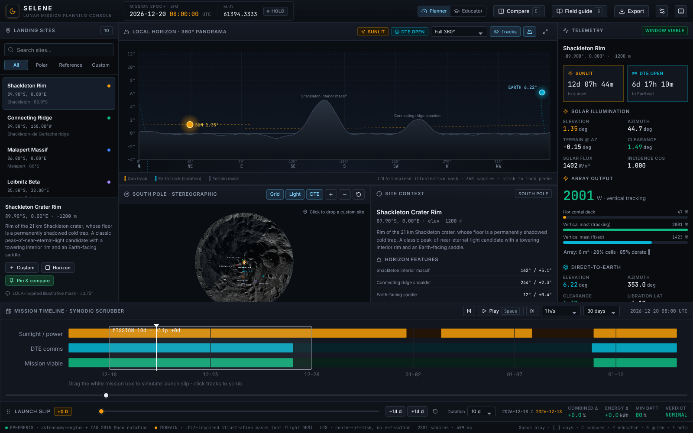

# SELENE · Lunar South Pole Mission Planning Console

An interactive, production-grade workspace for comparing **solar illumination**, **terrain occlusion**, and **Direct-to-Earth (DTE) communication** windows at lunar south-pole landing sites — built for the CLPS / Artemis launch-slip trade study.

The app boots directly into a mission-operations workspace. There is no marketing page. Every panel is live: scrub time, drag the mission window to simulate launch delay, pin up to four site + date + array scenarios, and export CSV / JSON reports.



---

## Quick start

```bash
cd "final draft 1"
npm install
npm run dev          # http://localhost:5173  (binds 0.0.0.0)
```

Production build and checks:

```bash
npm run build        # tsc --noEmit + vite build
npm test             # Vitest engine / physics / export unit tests
npm run test:browser # Playwright end-to-end interaction smoke test
npm run typecheck
```

> Paths contain a space (`final draft 1`). Always quote them in shell commands.

The dev server is configured with `allowedHosts: true` so it works behind Arena / e2b preview proxies.

---

## What you can do

| Capability | Where |
|---|---|
| Browse 7 polar CLPS/Artemis candidates + 3 historical benchmarks | Left site rail |
| Synthesize a custom site from coordinates or by clicking the map | **Custom** button / map click |
| Inspect a 360° terrain silhouette with Sun & Earth tracks | Horizon panorama |
| Lock a probe on the panorama to read azimuth / elevation / terrain | Click the sky plot |
| View a georeferenced LROC south-pole mosaic with lighting + DTE vector | Polar stereographic map |
| Scrub hours → synodic month → 90-day seasons | Timeline + range slider |
| Simulate a 0–60 day launch slip by dragging the mission box | Timeline / slip slider |
| Compare 2–4 pinned scenarios side-by-side | **Compare** (`C`) |
| Switch between Planner telemetry and Educator plain-English | Header mode switch (`E`) |
| Walk guided stories + glossary | **Field guide** (`G`) |
| Export mission report, timeseries, horizon mask, comparison | **Export** menu |

### Keyboard shortcuts

`Space` play/pause · `[` / `]` ±1 day · `←` / `→` ±1 hour · `C` compare · `E` educator · `G` field guide · `P` pin scenario · `?` help · `Esc` close overlays.

---

## Architecture

```text
final draft 1/
├── index.html
├── package.json / vite.config.ts / tsconfig.json
├── public/assets/              # LROC south-pole mosaic + provenance
├── scripts/browser-test.mjs    # Playwright E2E smoke test
├── screenshots/                # Captured during verification
├── src/
│   ├── main.tsx / App.tsx      # Entry + state orchestration
│   ├── types/mission.ts        # Domain interfaces
│   ├── data/
│   │   ├── landingSites.ts     # Curated sites + illustrative horizon masks
│   │   └── guidedScenarios.ts  # Educator stories + glossary
│   ├── engine/
│   │   ├── constants.ts
│   │   ├── ephemeris.ts        # astronomy-engine + IAU 2015 Moon rotation
│   │   ├── horizonPhysics.ts   # Terrain masks, occlusion, crossing refinement
│   │   ├── powerComms.ts       # Cosine power, battery integration, feasibility
│   │   ├── simulation.ts       # Window sampling + summary
│   │   ├── simulation.worker.ts# Off-main-thread simulation
│   │   └── simulationClient.ts # Cached worker request broker
│   ├── hooks/useSimulation.ts
│   ├── components/             # Header, catalog, panorama, map, telemetry,
│   │                           # timeline, comparison, educator, modals
│   ├── utils/export.ts         # CSV / JSON report generation
│   └── styles/index.css        # Aerospace design tokens + layout
└── tests/engine.test.ts        # Scientific sanity + unit tests
```

**Stack:** Vite 7 · React 19 · TypeScript 5.8 · Tailwind CSS 4 · `astronomy-engine` · `lucide-react` · HTML5 Canvas / SVG · Web Workers. Fonts are self-hosted (`@fontsource/inter`, `@fontsource/jetbrains-mono`).

Heavy window simulations run in a dedicated Web Worker with an LRU result cache, so time scrubbing and playback stay responsive. The instantaneous telemetry sample is computed synchronously on the main thread (sub-millisecond).

---

## Scientific model & honest limitations

### Ephemeris (real)
- Sun and Earth topocentric directions are computed with [`astronomy-engine`](https://github.com/cosinekitty/astronomy) and the **IAU 2015 Moon body-fixed rotation** (`RotationAxis(Body.Moon)`), transformed into a local east/north/up frame at the site’s selenographic latitude, longitude, and elevation.
- The Sun vector is back-dated for light time and corrected for first-order stellar aberration using the Moon’s heliocentric velocity. The Earth vector uses the light-time-corrected geocentric Moon position.
- **Optical libration emerges naturally** from the time-varying body frame: Earth traces its ~27.3-day loop (≈±6.7° latitude, ±7.9° longitude) near the polar horizon. The sub-Earth point and `astronomy-engine`’s `Libration()` are both exposed in telemetry.
- **No atmospheric refraction** is applied — the Moon is airless. Horizon cutoffs are razor-sharp.

### Terrain (illustrative, NOT flight DEM)
- Each curated site carries a deterministic 360° horizon elevation mask (1° resolution) built from named massif / rim / saddle features. These are **LOLA-inspired and illustrative**, shaped to reflect the real geological character of each site (e.g. Shackleton’s towering interior rim vs. an Earth-facing saddle). They are **not** measured LOLA digital elevation models.
- Uncertainty is shown as ±0.75° for curated masks. Custom sites use presets or an editable 8-sector mask.
- Visibility uses a **center-of-disk** criterion: an object is visible only if its elevation exceeds the terrain mask at that azimuth (plus a configurable DTE margin). Partial-disk illumination and antenna beam patterns are not modeled.
- The polar map uses a real **LROC WAC south-pole mosaic** (NASA/GSFC/ASU, 400 m/px, polar stereographic, 80°S–90°S). The dynamic lighting overlay is a geometric day/night shade, **not** a DEM shadow model.

### Coordinates & elevations
- Site latitude/longitude are the real published values requested in the challenge. Elevations are **representative** values for context, not surveyed lander altitudes.

### Power & survival (idealized engineering model)
- Solar flux = 1361 W/m² / (distance in AU)².
- `P = flux × area × cell efficiency × system derate × max(0, cos incidence)`.
  - Horizontal deck: incidence factor `sin(elevation)`.
  - Vertical mast (azimuth tracking): `cos(elevation)` — the key reason vertical arrays win at 89°S.
  - Vertical mast (fixed): `cos(elevation) × cos(azimuth offset)`.
- Battery state-of-charge integrates net power with 92% charge / 95% discharge efficiency. Depletion drives a **SURVIVAL RISK** verdict.
- Feasibility score weights combined visibility (45%), illumination (20%), DTE (15%), and survival (20%). Verdicts: `NOMINAL`, `CONDITIONAL`, `HIGH RISK`, `SURVIVAL RISK`, `RELAY REQUIRED`.

### Verified behaviors (unit tests)
- **Apollo 11**: ~14-day sunlit / ~14-day night cycle, peak Sun > 75°, Earth always > 45°, 100% DTE.
- **Shackleton Rim**: grazing Sun (< 4° peak), low Earth (< 12°), terrain-driven shadows and libration-driven DTE gaps.
- **Chang’e 4 (far side)**: Earth permanently below −30°, 0% DTE, `RELAY REQUIRED`.
- Libration sweeps > 9° latitude and > 11° longitude over 60 days.
- Terrain blocks objects that are geometrically above 0°; crossing refinement is sub-minute.

> **This is a planning and education tool, not a flight-certified analysis.** Replace the illustrative masks with measured LOLA DTMs and use SPICE/DE ephemerides before any operational decision.

---

## Design language

Obsidian `#090B0E` background, elevated `#12161F` panels, crisp `1px #1E2530` borders. Inter for UI, JetBrains Mono with `tabular-nums` for all telemetry. Semantic engineering colors:

- Solar / power → amber `#F59E0B`
- Earth / DTE → cyan `#06B6D4`
- Occlusion / LOS blocked → crimson `#EF4444`
- Simultaneous Sun + Earth viability → emerald `#10B981`

No gradients-for-gradient’s-sake, no glassmorphism, no rounded marketing cards. Reticles, scale bars, UTC/MJD clocks, and countdown timers behave like an ops console.

---

## Data & imagery provenance

- Landing-site coordinates: challenge specification; candidate regions per NASA Artemis III announcements (2022 / 2024).
- Moon rotation: IAU/IAG Working Group on Cartographic Coordinates and Rotational Elements, 2015 report.
- Ephemeris library: Don Cross, `astronomy-engine` (MIT).
- South-pole mosaic: NASA / GSFC / Arizona State University, LROC WAC, polar stereographic 400 m/px. See `public/assets/PROVENANCE.md`.

## License

Application code: MIT. Bundled LROC imagery is credited to NASA/GSFC/ASU and used for educational/scientific visualization.
